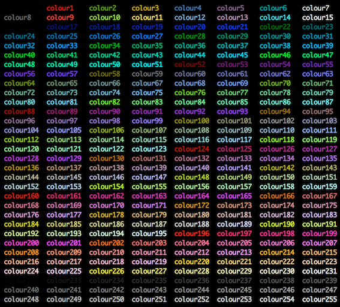

# tmux-agent-indicator

[](https://github.com/accessd/tmux-agent-indicator/actions/workflows/ci.yml)

AI agents run in tmux panes but give no signal when they finish or need input. You have to keep switching panes to check. This plugin tracks agent state and surfaces it through pane borders, window titles, and status bar icons so you never miss a transition.

## Demo

https://github.com/user-attachments/assets/b6b6b466-4b42-4d45-85aa-b9b659e4bafe

When the agent finishes, the window title background/foreground changes and the pane border updates to signal completion.

|  |  |  |
|:---:|:---:|:---:|
| needs-input: yellow window title | done: red window title | done: pane background change |

## How it works

The plugin tracks three states per pane: `running`, `needs-input`, and `done`.

State transitions are driven by hooks. Claude Code and Codex fire hooks on prompt submit, permission request, tool completion (back to `running` after an approved permission request), and stop. OpenCode uses its plugin system, and omp an extension. Any other agent can call `agent-state.sh` directly from a wrapper script or hook.

Each state can change:
- Pane border color
- Pane background (supported but disabled by default to avoid visual noise)
- Window title background and foreground
- Status bar icon (per-agent, e.g. `claude=🤖`, `codex=🧠`)

States reset when you focus the pane/window, or on the next transition.

Window title and active-border styles are shared by every pane of a window. With several agents in one window they show the most urgent state (`needs-input` > `done` > `running`). Your own window styles come back once no agent pane needs them. When a pane closes, its state is dropped and its window styling is restored.

## Features

- Per-agent status icons in the status bar
- Knight Rider animation during `running` state
- Deferred pane reset: keep pane colors until focus, not when the hook fires
- Process detection fallback for agents that don't fire hooks
- Agents on remote hosts over SSH, shown in the pane you connected from
- Tmux display-message notifications on state transitions

## Requirements

tmux 3.1+ (`@agent-indicator-notification-duration` needs tmux 3.2+; older versions fall back to `display-time`), bash 4+, Python 3

## Installation

### One-command installer (recommended)

```bash
curl -fsSL https://raw.githubusercontent.com/accessd/tmux-agent-indicator/main/install.sh | bash
```

The installer will offer to run the interactive color setup wizard (it reads from your terminal, so this also works under `curl | bash`). You can also run it later:

```bash
bash ~/.tmux/plugins/tmux-agent-indicator/setup.sh
```

This installs files to `~/.tmux/plugins/tmux-agent-indicator` and updates:
- `~/.claude/settings.json` hooks for Claude (`UserPromptSubmit`, `PermissionRequest`, `PostToolUse`, `PostToolUseFailure`, `Stop`); honors `CLAUDE_CONFIG_DIR`
- `~/.codex/hooks.json` hooks for Codex (`UserPromptSubmit`, `PermissionRequest`, `PostToolUse`, `Stop`); honors `CODEX_HOME` (or `CODEX_CONFIG_DIR`)
- `~/.config/opencode/plugins/` plugin for OpenCode

The installer refuses to touch a settings/hooks file that is not valid JSON (it exits with an error and leaves the file as is). Before rewriting a file it saves the previous content to `<file>.bak`.

After installing Codex hooks, run `/hooks` in Codex and trust the tmux-agent-indicator hook definitions before they can run.

Integration uninstall options (only the requested removals run; nothing is copied or installed):

```bash
./install.sh --uninstall-claude
./install.sh --uninstall-codex
./install.sh --uninstall-opencode
```

Uninstalling only removes the plugin's hooks (and unwraps the Claude status line); all other settings are preserved.

### TPM

Add to ~/.tmux.conf:

```tmux
set -g @plugin 'accessd/tmux-agent-indicator'
```

Reload tmux:

```bash
tmux source-file ~/.tmux.conf
```

### Nix / Home Manager

The flake provides the plugin as `packages.<system>.default` and a Home Manager module as `homeModules.default`:

```nix
# flake.nix
inputs.tmux-agent-indicator = {
  url = "github:accessd/tmux-agent-indicator";
  inputs.nixpkgs.follows = "nixpkgs";
};

# home-manager modules
imports = [ inputs.tmux-agent-indicator.homeModules.default ];

programs.tmux.agentIndicator = {
  enable = true;
  # @agent-indicator-* options without the prefix; booleans become on/off
  settings = {
    icons = "claude=🤖,codex=🧠,default=🤖";
    notification-enabled = false;
  };
  # Emitted just before the plugin loads, so #{agent_indicator} is expanded
  extraConfig = ''
    set -g status-right "#{agent_indicator} | %H:%M"
  '';
  integrations = {
    claude.enable = true; # merges hooks into ~/.claude/settings.json on activation
    codex.enable = true; # merges hooks into ~/.codex/hooks.json; trust them with /hooks
    opencode.enable = true; # links the plugin into ~/.config/opencode/plugins
    omp.enable = true; # links the extension into ~/.omp/agent/extensions
  };
};
```

Hooks point at the store copy of the plugin, and hooks from older generations are replaced on each switch. `programs.tmux.agentIndicator.dir` is the plugin directory, for calling its scripts (for example `session-attention.sh`) from other configuration. The module does not wrap Claude's status line, so `#{agent_limits}` uses `~/.claude.json` for Claude. The package bundles its own `python3` for `#{agent_limits}`, so no global Python is needed.

Turning off `claude.enable` or `codex.enable` (or the whole module while it is still imported) removes the store-path hooks the module merged earlier on the next switch, so they don't dangle after garbage collection. Only hooks pointing into the Nix store are removed; hooks from a TPM/`install.sh` setup, your own hooks, and unrelated keys are kept, and the file is never created. If you drop the module import entirely, nothing runs on activation: set `enable = false` for one switch first, or delete the hooks by hand.

## Status Bar Integration

For native status:

```tmux
set -g status-right '#{agent_limits} #{agent_indicator} | %H:%M'
```

For [minimal-tmux-status](https://github.com/niksingh710/minimal-tmux-status):

```tmux
set -g @minimal-tmux-status-right '#{agent_limits} #{agent_indicator} #(gitmux "#{pane_current_path}")'
```

## Agent limits

`#{agent_limits}` shows the shortest active account-limit window for Claude and Codex:

```text
C 5h 4% used · X 7d 2% used
```

Percentages are used allowance, matching the provider dashboards. `C` means Claude and `X` means Codex. These limits are account-wide, so every pane using the same provider shares them.

The collector reads local agent data:

- Claude: `cachedUsageUtilization` from `~/.claude.json`, plus fresh `rate_limits` captured from Claude's status-line input
- Codex: the newest `token_count.rate_limits` snapshot under `~/.codex/sessions/`

The installer wraps an existing Claude status-line command and passes its input and output through unchanged. `--uninstall-claude` restores the previous command. Expired data is hidden.

Configuration:

```tmux
set -g @agent-indicator-limits-enabled 'on'
set -g @agent-indicator-limits-providers 'claude,codex'
set -g @agent-indicator-limits-cache-seconds '60'
```

Omit a provider to hide it. Set the cache duration to `0` to read the source files on every status refresh.

## Session Dots

Optional visual session indicator in the status bar. Shows all sessions as symbols with the current one highlighted. Sessions where agents need attention (`needs-input` or `done` state) are highlighted in a different color.

Includes code from [tmux-session-dots](https://github.com/jtmcginty/tmux-session-dots) by [Jack McGinty](https://github.com/jtmcginty), used under the [MIT License](licenses/tmux-session-dots.txt).

Example with 4 sessions, second is current, fourth needs attention: `○●○●`

With emoji symbols:


```tmux
set -g @agent-indicator-session-dots-active '🌕'
set -g @agent-indicator-session-dots-inactive '🌑'
set -g @agent-indicator-session-dots-attention '🤖'
```

Add `#{agent_session_dots}` to your status bar:

```tmux
set -g status-right '#{agent_session_dots} #{agent_indicator} | %H:%M'
```

Configuration:

```tmux
# Symbols
set -g @agent-indicator-session-dots-active '●'
set -g @agent-indicator-session-dots-inactive '○'
set -g @agent-indicator-session-dots-attention '●'

# Colors (empty = inherit from status bar)
set -g @agent-indicator-session-dots-color ''
set -g @agent-indicator-session-dots-active-color ''
set -g @agent-indicator-session-dots-attention-color 'yellow'

# Which agent states trigger attention highlighting (comma-separated)
set -g @agent-indicator-session-dots-attention-states 'needs-input,done'
```

The current session always shows as the active dot, even if it also has agents needing attention.

### Session attention

`scripts/session-attention.sh` reports the same attention set for other tools (session pickers, custom status segments). A session counts while one of its panes is in an `@agent-indicator-session-dots-attention-states` state and it hasn't been marked seen; `needs-input` outranks `done`.

```sh
# One line per session: <session>\t<state>\t<window-title-bg>\t<window-title-fg>
scripts/session-attention.sh --exclude "$(tmux display-message -p '#S')"

# Window-title background of the most urgent session, or the fallback
scripts/session-attention.sh --exclude "$current" --color colour4
```

The colours are the window-title colours that state applies (`@agent-indicator-<state>-window-title-bg/fg`), so a status segment can match them:

```tmux
set -g status-left "#[fg=#(/path/to/scripts/session-attention.sh --exclude '#S' --color colour4)]● #[default]#S "
```

## Configuration

Quick start with the most useful options:

```tmux
# Enable/disable visual channels
set -g @agent-indicator-border-enabled 'on'
set -g @agent-indicator-indicator-enabled 'on'

# Per-agent icons
set -g @agent-indicator-icons 'claude=🤖,codex=🧠,opencode=💻,default=🤖'

# Keep pane colors until you focus the pane (instead of clearing immediately)
set -g @agent-indicator-reset-on-focus 'on'

# Knight Rider animation while running
set -g @agent-indicator-animation-enabled 'on'
```

<details>
<summary>Full configuration reference</summary>

```tmux
# Global toggles
set -g @agent-indicator-background-enabled 'on'
set -g @agent-indicator-border-enabled 'on'
set -g @agent-indicator-indicator-enabled 'on'

# Account limits
set -g @agent-indicator-limits-enabled 'on'
set -g @agent-indicator-limits-providers 'claude,codex'
set -g @agent-indicator-limits-cache-seconds '60'

# Running state (default keeps pane/border unchanged)
set -g @agent-indicator-running-enabled 'on'
set -g @agent-indicator-running-bg 'default'
set -g @agent-indicator-running-border 'default'
set -g @agent-indicator-running-window-title-bg ''
set -g @agent-indicator-running-window-title-fg ''

# Needs-input state
set -g @agent-indicator-needs-input-enabled 'on'
set -g @agent-indicator-needs-input-bg 'default'
set -g @agent-indicator-needs-input-border 'yellow'
set -g @agent-indicator-needs-input-window-title-bg 'yellow'
set -g @agent-indicator-needs-input-window-title-fg 'black'

# Done state
set -g @agent-indicator-done-enabled 'on'
set -g @agent-indicator-done-bg 'default'
set -g @agent-indicator-done-border 'green'
set -g @agent-indicator-done-window-title-bg 'red'
set -g @agent-indicator-done-window-title-fg 'black'

# Per-agent icons
set -g @agent-indicator-icons 'claude=🤖,codex=🧠,opencode=💻,default=🤖'

# Per-state icons for hook-reported states, e.g. 'running=⚡,needs-input=❓,done=✅'
# (override per-agent icons; states without an entry fall back to them)
set -g @agent-indicator-state-icons ''

# Process fallback detection: a pane counts as running an agent when a process
# on its tty has one of these names as executable (argv[0] basename, or the
# script basename for `node`/`bun`/`deno`/`python`/`ruby` launchers).
# Names appearing only as arguments (`vim ~/.claude/settings.json`) do not match.
set -g @agent-indicator-processes 'claude,codex,aider,cursor,opencode'

# Keep pane colors until pane focus-in after done
set -g @agent-indicator-reset-on-focus 'on'

# Running animation in status indicator (speed: milliseconds per frame)
set -g @agent-indicator-animation-enabled 'off'
set -g @agent-indicator-animation-speed '300'

# Notifications (tmux display-message on state transitions)
set -g @agent-indicator-notification-enabled 'on'
set -g @agent-indicator-notification-states 'needs-input,done'
set -g @agent-indicator-notification-format '[#{agent_name}] #{agent_state} (#{session_name}:#{window_name})'
set -g @agent-indicator-notification-duration '5000'
set -g @agent-indicator-notification-command ''

# Session dots (visual session indicator in status bar)
set -g @agent-indicator-session-dots-active '●'
set -g @agent-indicator-session-dots-inactive '○'
set -g @agent-indicator-session-dots-attention '●'
set -g @agent-indicator-session-dots-color ''
set -g @agent-indicator-session-dots-active-color ''
set -g @agent-indicator-session-dots-attention-color 'yellow'
set -g @agent-indicator-session-dots-attention-states 'needs-input,done'
```

Pane background coloring is unchanged by default (`*-bg 'default'` for all states).
To enable background colors, set per-state values in your `~/.tmux.conf`, for example:

```tmux
set -g @agent-indicator-needs-input-bg 'colour94'
set -g @agent-indicator-done-bg 'green'
```

Empty option values are treated as "do not apply this property" (for toggles, empty behaves as disabled). `default` resets the property (pane background to the terminal default, border to the window's original style). A disabled channel (`@agent-indicator-background-enabled` / `-border-enabled` set to `off`) resets it for every state. Example:

```tmux
set -g @agent-indicator-done-bg ''
```

This skips done-state background changes while still allowing done border/title styles.

Note: tmux border coloring is window-scoped (`pane-active-border-style` / `pane-border-style`).
You can style the active border differently, but tmux cannot set a fully independent border color for one arbitrary non-active pane.

</details>

<details>
<summary>Color presets</summary>

Preset 1 (Balanced):

```tmux
set -g @agent-indicator-running-bg ''
set -g @agent-indicator-running-border ''
set -g @agent-indicator-needs-input-bg 'colour223'
set -g @agent-indicator-needs-input-border 'colour214'
set -g @agent-indicator-done-bg ''
set -g @agent-indicator-done-border 'colour34'
set -g @agent-indicator-done-window-title-bg 'colour34'
set -g @agent-indicator-done-window-title-fg 'black'
```

Preset 2 (High Contrast):

```tmux
set -g @agent-indicator-running-bg 'colour52'
set -g @agent-indicator-running-border 'colour196'
set -g @agent-indicator-needs-input-bg 'colour94'
set -g @agent-indicator-needs-input-border 'colour226'
set -g @agent-indicator-done-bg ''
set -g @agent-indicator-done-border 'colour46'
set -g @agent-indicator-done-window-title-bg 'colour46'
set -g @agent-indicator-done-window-title-fg 'black'
```

Preset 3 (Subtle):

```tmux
set -g @agent-indicator-running-bg ''
set -g @agent-indicator-running-border 'colour244'
set -g @agent-indicator-needs-input-bg ''
set -g @agent-indicator-needs-input-border 'colour220'
set -g @agent-indicator-done-bg ''
set -g @agent-indicator-done-border 'colour70'
set -g @agent-indicator-done-window-title-bg 'colour238'
set -g @agent-indicator-done-window-title-fg 'colour194'
```

</details>

<details>
<summary>Tmux color reference</summary>

Tmux supports:
- 8 basic colors: `black`, `red`, `green`, `yellow`, `blue`, `magenta`, `cyan`, `white`
- Bright variants (`brightred`, `brightblue`, etc.)
- 256-color palette: `colour0` ... `colour255`



</details>

## Notifications

State transitions trigger a `tmux display-message` notification. Enabled by default for `needs-input` and `done` states.

```tmux
# Disable notifications entirely
set -g @agent-indicator-notification-enabled 'off'

# Only notify on done
set -g @agent-indicator-notification-states 'done'

# Custom format
set -g @agent-indicator-notification-format '#{agent_name} is #{agent_state} in #{session_name}'

# Duration in milliseconds (0 = use tmux default display-time; needs tmux 3.2+)
set -g @agent-indicator-notification-duration '3000'
```

Available format placeholders: `#{agent_name}`, `#{agent_state}`, `#{session_name}`, `#{window_name}`, `#{window_index}`.

You can also run an external command on each notification. It runs in the background, detached from the agent hook's input and output. The command receives environment variables `AGENT_NAME`, `AGENT_STATE`, `AGENT_SESSION`, and `AGENT_WINDOW`:

```tmux
# Log notifications to a file
set -g @agent-indicator-notification-command 'echo "$AGENT_NAME $AGENT_STATE" >> /tmp/agent-notify.log'

# macOS system notification
set -g @agent-indicator-notification-command 'osascript -e "display notification \"$AGENT_NAME is $AGENT_STATE\" with title \"tmux agent\""'
```

## Custom Agent Integration

To integrate any agent that does not have built-in hook support, call `agent-state.sh` from your agent's hooks or wrapper script.

```bash
~/.tmux/plugins/tmux-agent-indicator/scripts/agent-state.sh --agent claude --state running
~/.tmux/plugins/tmux-agent-indicator/scripts/agent-state.sh --agent claude --state needs-input
~/.tmux/plugins/tmux-agent-indicator/scripts/agent-state.sh --agent claude --state done
~/.tmux/plugins/tmux-agent-indicator/scripts/agent-state.sh --agent claude --state off
```

`--state off` always resets pane background and border immediately. `--state running` also clears leftover `done`/`needs-input` styling of its pane, so you don't need to send `off` before it. Repeated `running` reports for a pane that is already running return right away, so you can send them after every tool call.

Agents on another machine reach the pane through [Agents over SSH](#agents-over-ssh).

## Agents over SSH

Agents running on another machine can drive the pane you ssh from. Connect with `scripts/agent-ssh.sh` instead of `ssh`; it takes the same arguments:

```bash
alias ssh="$HOME/.tmux/plugins/tmux-agent-indicator/scripts/agent-ssh.sh"
```

With the Home Manager module the path is `${config.programs.tmux.agentIndicator.dir}/scripts/agent-ssh.sh`.

Install the plugin on the remote host too: `install.sh` there sets up the agent hooks (tmux is not needed on that host). The hooks call `agent-state.sh`, which sends each state back over the SSH connection, so the local pane gets the same border, window title, status icon and notifications as a local agent. When the connection ends, the pane's agent state is cleared. Outside tmux the wrapper is plain `ssh`.

How it works: `agent-ssh.sh` starts a relay (`scripts/agent-relay.py`, Python 3) on a private local socket, forwards a random socket in the remote `/tmp` to it (`ssh -R`, the remote socket is mode 0600) and passes that path in `LC_TMUX_AGENT_SOCKET`. The relay applies only well-formed `<agent> <state>` lines, and only to the pane the connection runs in.

Requirements and caveats:

- The remote sshd must accept `LC_TMUX_AGENT_SOCKET`. Debian and Ubuntu ship `AcceptEnv LANG LC_*`; elsewhere add `AcceptEnv LC_TMUX_AGENT_SOCKET` to `sshd_config`.
- Unix socket forwarding must be allowed (`AllowStreamLocalForwarding`, on by default). If it is not, ssh prints `remote port forwarding failed` and the session works without agent states.
- The remote host sends states with `socat`, `python3` or `nc -U`, whichever is found first.
- With `ControlMaster`, a multiplexed session only receives the environment variables the master connection's `SendEnv` allows. Add `SendEnv LC_TMUX_AGENT_SOCKET` to the host in `~/.ssh/config` unless `/etc/ssh/ssh_config` already sends `LC_*` (Debian and Ubuntu do).
- tmux on the remote host: panes inherit `LC_TMUX_AGENT_SOCKET` from the connection that started the tmux server. Add `set -ga update-environment LC_TMUX_AGENT_SOCKET` to the remote `~/.tmux.conf` so that, after you reattach from a new connection, existing panes report through it. Every agent in that remote session reports to the one local pane; the latest state wins. If the remote tmux loads the plugin too, it shows the states as well.
- sshd does not delete forwarded sockets, so each connection leaves an unused socket file in the remote `/tmp` until it is cleaned.

## Hook Templates

Default template files:
- `hooks/claude-hooks.json`
- `hooks/codex-hooks.json`

The installer uses these templates as the source for Claude and Codex hook configuration, replacing the default plugin path with the selected install target.

They map:
- `UserPromptSubmit` -> `running`
- `PermissionRequest` -> `needs-input`
- `PostToolUse` (and `PostToolUseFailure` for Claude) -> `running`, so an approved permission request goes back to running
- `Stop` -> `done`

Codex hooks must be reviewed and trusted with `/hooks` before they can run.

## OpenCode Plugin

The installer copies `plugins/opencode-tmux-agent-indicator.js` to `~/.config/opencode/plugins/`. The plugin uses OpenCode's event system:
- `session.status` (busy) -> `running`
- `permission.updated` -> `needs-input`
- `session.idle` -> `done`

To install manually without the installer, copy the plugin file:

```bash
mkdir -p ~/.config/opencode/plugins
cp plugins/opencode-tmux-agent-indicator.js ~/.config/opencode/plugins/
```

Only the root session drives the pane: events from subagent (task tool) sessions are ignored. A plugin file that is symlinked from a checkout or Nix store path (its real location has `../scripts/agent-state.sh`) uses those scripts; a copied file falls back to `$TMUX_AGENT_INDICATOR_DIR`, then `~/.tmux/plugins/tmux-agent-indicator`.

## omp Extension

`plugins/omp-tmux-agent-indicator.ts` drives the indicator from [oh-my-pi](https://github.com/can1357/oh-my-pi) lifecycle events, ignoring subagent sessions:
- `agent_start` -> `running`
- `tool_approval_requested`, `ask` tool start -> `needs-input`
- `tool_approval_resolved`, `ask` tool end -> `running`
- `agent_end` -> `done`, only when the end is terminal (an auto-retry, compaction continuation or pending background-job delivery keeps `running`)
- `session_shutdown` -> `off`

omp auto-loads extensions from `~/.omp/agent/extensions/`. Symlink the file so it keeps using the scripts next to it:

```bash
mkdir -p ~/.omp/agent/extensions
ln -s ~/.tmux/plugins/tmux-agent-indicator/plugins/omp-tmux-agent-indicator.ts ~/.omp/agent/extensions/tmux-agent-indicator.ts
```

A copied file falls back to `$TMUX_AGENT_INDICATOR_DIR`, then `~/.tmux/plugins/tmux-agent-indicator`. Add `omp` to `@agent-indicator-processes` and `@agent-indicator-icons` to show its icon before the first event.

## License

MIT
